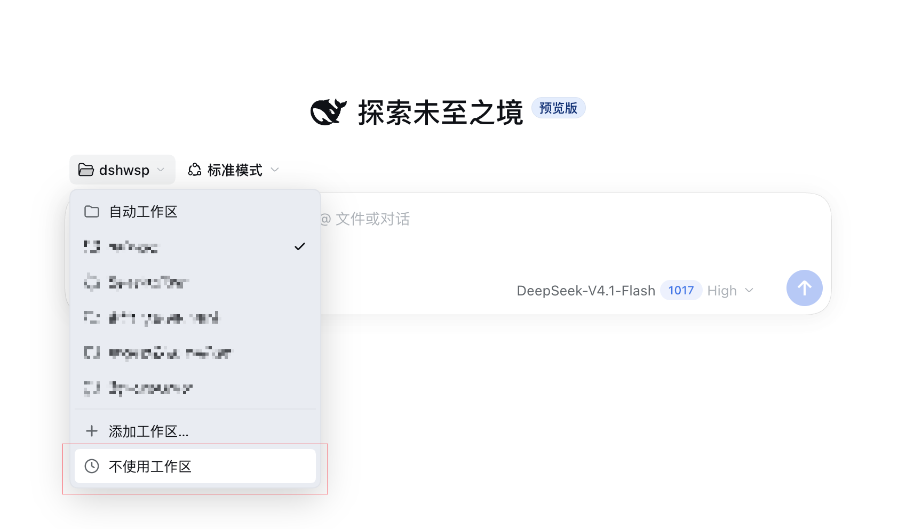

# no-need-workspace

[English](README.md) | **简体中文**

一个 DeepSeek Harness 插件包（bundle），在空白会话的工作区选择器中新增
**不使用工作区** 操作。它把文件夹的创建推迟到第一条消息，并让这类会话统一归入
同一个 **无需工作区** 父级。

## 使用效果



空白会话的工作区选择器中，**不使用工作区** 选项位于菜单底部。

## 行为

- 点击 **不使用工作区** 时，只会确保并选中位于 `$DSH_HOME/workspaces` 的共享
  “桶”工作区，不会立即为会话创建独立文件夹。
- 该会话中的第一条消息会创建
  `$DSH_HOME/workspaces/YYYY-MM-DD_HH-mm-ss`（若同一秒已存在同名文件夹，则追加
  数字后缀），并把会话的工作目录切换到该文件夹。
- 会话头部始终指向这个“桶”工作区，因此左侧栏会把这类会话都显示在
  **无需工作区** 分组下；带时间戳的文件夹不会注册为独立工作区，因此不会形成
  文件夹树。
- 原有的 **添加工作区…** 操作仍然使用组合目录选择器；侧边栏的 `+` 操作保持不变。

`$DSH_HOME` 是配置的 Harness 主目录（环境变量 `$DSH_HOME`），未配置时回退到
`~/.dsh`。不会自动删除任何文件夹。

## 安装

DSH 以 bundle 形式自带插件管理器。请从 Web 的 **插件** 页面按包名安装
`no-need-workspace`，或通过 `plugin_manager` agent 工具：

```json
{ "action": "install_bundle", "target": "no-need-workspace@0.2.1" }
```

该包声明了 `dsh.bundle.patch`，因此安装时会选中该 bundle，并插入它唯一的
Host/Client 行。

## DSH 插件市场索引

仓库根目录包含 [`market.json`](market.json)，即一个 format 1 的 DSH 插件市场
索引。把它托管在公开的 HTTPS URL 上（例如该文件的 raw GitHub 地址），然后在
DSH 的 **设置 → 插件市场** 中添加该 URL。索引中列出了 `0.2.1` 的 npm 来源；
后续版本由下方「发布」一节中的 `Release` 工作流自动追加，`publishTimestamp`
取该版本的发布时间。

## 发布

1. 修改 [`package.json`](package.json) 中的 `version` 并提交到 `main`。
2. 打 tag 并推送：

   ```bash
   git tag v0.2.1
   git push origin v0.2.1
   ```

`Release` 工作流会先校验 tag 与 `package.json` 的版本一致、且 tag 指向 `main`
上的提交，然后发布到 npm，再运行
[`scripts/update-market.mjs`](scripts/update-market.mjs) 并把新的 `market.json`
条目提交回 `main`。发布使用 npm **可信发布（trusted publishing）**：包只需在
npm 侧信任本仓库和 `release.yml` 一次（npm → 包的 Trusted publishing 设置，或
`npm trust github`），工作流凭 GitHub OIDC 和 `id-token: write` 权限完成认证，
仓库里不保存任何 npm token。npm 拒绝重复发布同一版本，因此部分失败后重新打 tag
也不会产生重复条目。

## 兼容性

- 需要 DSH `>=0.2.1-rc.2 <0.3.0`（`engines.dsh`）。
- 浏览器端有意覆盖内置的 `conversation.hero.workspace` 插槽（`single` 类型的
  插槽，以优先级 `-100` 注册）。它依赖该插槽属主的 props，以及所锁定 DSH 版本线
  中的客户端服务 `workspaces.rename` / `uiWorkspace.pickDirectory`。升级 DSH 后
  请重新验证选择器。
- 不要与其他注册了相同 `/no-need-workspace/ensure-bucket` 路由的插件一起安装，
  也不要同时运行两个自动工作区插件：否则每个插件都会在第一条消息时各自分配一个
  带时间戳的文件夹。

## 安全

Host 端只注册一个仅限回环、同源的 `POST` 路由，并由 `x-no-need-workspace: 1`
请求头校验。它只在 `$DSH_HOME/workspaces` 下创建空目录。不会添加任何模型提示、
工具或遥测。

## 许可证

MIT。参见 [LICENSE](LICENSE)。
